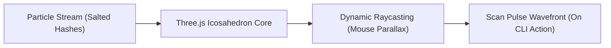

# SENTRIS PRO — World-Class Product Design System & Anti-Slop Specification v3.0

> **Target Platform:** Sentris Pro SaaS & Commercial Team Platform ($8/seat Pro Tier)  
> **Aesthetic Philosophy:** *Industrial Precision, Aerospace Telemetry & Zero-Knowledge Cryptography*  
> **Core Tenet:** *No AI Slop. Zero generic purple gradients. Zero floaty animations. Zero filler copy. Pure mechanical craftsmanship.*

---

## 1. The Anti-Slop Manifesto (Why 95% of AI Web Designs Fail)

Modern AI coding tools and generic web templates suffer from **"Distributional Convergence"**—averaging out the 2021–2024 SaaS aesthetic into indistinguishable slop. Sentris rejects these clichés with surgical precision:

```
┌──────────────────────────────────────────────┬──────────────────────────────────────────────┐
│       AI SLOP / GENERIC TEMPLATE FLUFF       │      SENTRIS WORLD-CLASS CRAFTSMANSHIP       │
├──────────────────────────────────────────────┼──────────────────────────────────────────────┤
│ ❌ Fuzzy purple-to-cyan gradient blobs        │ ✅ Deep Obsidian background with laser grids │
│ ❌ Default Inter font with wide tracking     │ ✅ Architectural display sans + Mono paired  │
│ ❌ Repeating 3-column cards with fake text   │ ✅ Interactive telemetry feeds & live CLIs   │
│ ❌ Floaty, bouncy, aimless UI animations     │ ✅ GSAP mechanical spring & snap physics     │
│ ❌ "Unleash next-gen synergy with AI magic"  │ ✅ "Sub-50ms scans. Auto-fix in 15 seconds." │
│ ❌ Static mockups with fake gray rectangles   │ ✅ Real-time Three.js 3D Cryptographic Mesh  │
│ ❌ Hidden "Contact Sales" enterprise walls   │ ✅ Transparent $8/dev/mo self-serve pricing  │
└──────────────────────────────────────────────┴──────────────────────────────────────────────┘
```

---

## 2. Color System & Materiality Tokens

The Sentris palette is derived from physical security instrumentation, high-reliability server racks, and cryptographic hardware security modules (HSMs).

### 2.1 Base Surfaces & Obsidian Depth
* **Canvas Void (`--bg-void`):** `#07080B` — Absolute dark with a 1.5% blue-gray undertone to prevent OLED harshness.
* **Surface Layer 1 (`--bg-surface-1`):** `#0D0F15` — Subdued slate container for major page panels.
* **Surface Layer 2 (`--bg-surface-2`):** `#141722` — Elevated card and interactive workbench panels.
* **Surface Interactive (`--bg-surface-hover`):** `#1A1E2D` — Hover and focus highlights.
* **Surface Inset (`--bg-inset`):** `#050608` — Recessed terminal simulators and code blocks.

### 2.2 Chromatic Accents (Safety & Instrumentation)
* **Cadmium Voltage (`--accent-cadmium`):** `#FF5500` — High-visibility alert and primary call-to-action color. Evokes physical warning switches.
* **Critical Crimson (`--status-critical`):** `#FF3366` — Live leak and critical vulnerability badge.
* **Phosphor Emerald (`--status-emerald`):** `#10B981` (Phosphor glow: `#00F0A0`) — Clean repository state, active remediation success, verified HMAC chain.
* **Cyber Cobalt (`--accent-cobalt`):** `#2563EB` — Zero-knowledge network nodes and encrypted packets.
* **Signal Amber (`--status-warning`):** `#F59E0B` — High-entropy candidate warning.

### 2.3 Hairlines & Optical Borders
* **Hairline Subtle (`--border-subtle`):** `rgba(255, 255, 255, 0.08)` — Crisp 1px divider.
* **Hairline Elevated (`--border-elevated`):** `rgba(255, 255, 255, 0.14)` — Active container border.
* **Hairline Focus (`--border-focus`):** `rgba(255, 85, 0, 0.50)` — Focus rings and active cards.
* **Specular Highlight (`--specular-inner`):** `inset 0 1px 0 rgba(255, 255, 255, 0.12)` — Tactile edge bevel.

---

## 3. Typography Architecture

Pairing a high-impact architectural neo-grotesque with an uncompromising technical monospace creates immediate authority.

| Role | Font Family | Size / Leading | Letter Tracking | Application |
|---|---|---|---|---|
| **Display Hero** | Plus Jakarta Sans / Syne | `56px–72px / 1.05` | `-0.04em` (Tight) | Main landing headlines |
| **Section Title** | Plus Jakarta Sans | `32px–40px / 1.15` | `-0.03em` | Feature & architecture headings |
| **Card Header** | Plus Jakarta Sans | `18px–22px / 1.25` | `-0.02em` | Panel titles & metric labels |
| **Telemetry Mono** | JetBrains Mono / Geist Mono | `13px–14px / 1.4` | `+0.02em` | Code diffs, CLI terminals, hashes |
| **Micro Badge** | JetBrains Mono | `11px / 1.0` | `+0.06em` (Caps) | Zone badges, status pills, severity |
| **Body Editorial** | Plus Jakarta Sans / Inter | `15px–16px / 1.55` | `-0.01em` | Technical explanations & specs |

---

## 4. 3D Spatial Reactor Spec (Three.js Engine)

The hero section features a real-time, interactive **3D Zero-Knowledge Cryptographic Hash Mesh**:



### 4.1 Visual Components
1. **Cryptographic Core:** Wireframe icosahedron (`THREE.IcosahedronGeometry(2.2, 2)`) with glowing cyan-blue vertex points and semi-transparent faces (`opacity: 0.15`).
2. **Orbiting Salt Nodes:** 120 orbiting particles representing salted SHA-256 tokens streaming along elliptical trajectories.
3. **Scan Pulse Shader:** When user triggers `sentris scan` in the interactive terminal, an expanding glowing cadmium shockwave ripples outward from the reactor center.
4. **Camera Physics:** Smooth mouse tracking with inertia damping (`lerp(target, 0.05)`), producing a weighty physical feel.

---

## 5. Motion Grammar (GSAP Mechanical Physics)

Sentris animations never "float" or "bounce" like cartoon assets. Motion obeys physical laws of high-speed instrumentation:

* **Snap & Settle Curve:** `power3.out` (0.35s duration) for tab switches and menu drawers.
* **Mechanical Easing:** `expo.out` (0.6s duration) for modal presentation and card reveals.
* **Numerical Ticker Scrubbing:** Linear numerical counters scrubbing through scan speeds (`18ms`, `5,000 files`, `$8/seat`) triggered on scroll.
* **Terminal Typing Pipeline:** Realistic developer typing simulation (25ms key intervals) with flickering cursor (`steps(1)`).

---

## 6. Atomic Component Library Architecture

### 6.1 Interactive Terminal Simulator (`<TerminalSim />`)
* Embedded macOS/Linux dark terminal window with traffic light header pills (`#FF5F56`, `#FFBD2E`, `#27C93F`).
* Live execution sequence:
  1. Types `sentris scan --staged`
  2. Runs parallel worker thread animation (<18ms elapsed)
  3. Displays detected Stripe / AWS credential with redacted preview (`sk_live_51...f89a`)
  4. Interactive prompt: `Auto-remediate with Safe Dual-Key Rotation? [Y/n]`
  5. Upon `Y`, animates 7-step safe rotation timeline with live `.env` patch and git commit diff!

### 6.2 Interactive $8/seat Pro Pricing Calculator (`<PricingCalculator />`)
* **Seat Count Slider:** Range from 1 to 250 developers.
* **Billing Toggle:** Monthly ($8/dev/mo) vs Annual ($7/dev/mo - 12.5% discount).
* **Live ROI Engine:**
  - *Monthly Cost:* `Seats × $8`
  - *Engineering Hours Saved:* `Seats × 2.5 hrs/mo`
  - *Value Recovered:* `Hours × $110/hr Blended Dev Rate`
  - *ROI Ratio:* `(Value Recovered / Monthly Cost) × 100%` (typically > 3,400% ROI!)

### 6.3 Pro SaaS Team Dashboard (`<TeamDashboard />`)
* **Telemetry Feed:** Real-time stream of incoming scans from team members displaying repository, branch, zone, and salted HMAC-SHA256 fingerprint.
* **Seat Utilization Bar:** Progress meter showing active seats used (e.g. 14 / 20 seats occupied).
* **Cryptographic SOC 2 Ledger Viewer:** Verified hash chain display with tamper-evident SHA-256 seal.
* **One-Click Autonomous Remediation Panel:** Triggers dual-key safe rotation directly from the cloud UI with instant rollback option.

---

## 7. Copywriting Guidelines (High-Impact Technical Tone)

1. **Be Ruthlessly Specific:** Never say "fast scan". Say "Scans 5,000 files in 180ms using Rayon multithreading."
2. **Highlight the Wedge:** "Detection is a commodity. Autonomous remediation with zero production downtime in 15 seconds is the 10x product."
3. **Respect Privacy:** "Zero-Knowledge Architecture: We only receive salted SHA-256 hashes. Your proprietary code and raw keys never leave your terminal."
4. **Clear Economic ROI:** "At $8/seat, preventing a single AWS leak pays for Sentris Pro for the next 20 years."
