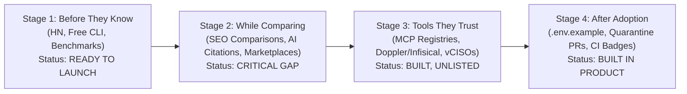

# Sentris Distribution Blueprint & Marketing Engineer Agent Playbook

> **Premise:** AI coding agents can now reverse-engineer and clone software features in days. When anyone can rebuild detection rules or CLI wrappers, **how Sentris reaches developers and security teams is the moat competitors cannot copy with code.**

---

## 1. Sentris's Uncopyable Distribution Assets

Competitors (`Gitleaks`, `TruffleHog`, `GitGuardian`, `Betterleaks`, `Kingfisher`) can write regexes or wrap a scanner in Rust. They cannot copy:
1. **Workflow Default Placement:** Pre-commit hooks ([`.pre-commit-hooks.yaml`](../.pre-commit-hooks.yaml)), CI/CD pipelines ([`action.yml`](../action.yml)), IDE Language Servers ([`src/lsp/`](../src/lsp/)), and AI Agent MCP configs ([`.mcp.json`](../.mcp.json)) already installed in developer repos.
2. **Bridge Compatibility (`--from-report`):** Sentris doesn't force teams to rip out `Gitleaks` or `Betterleaks` on day one—it ingests their JSON reports and owns the **80% post-detection remediation gap** (`sentris fix --from-report gitleaks.json`).
3. **Earned Citations in AI Answers & Benchmarks:** Reproducible corpus benchmarks ([`bench/results/latest.md`](../bench/results/latest.md)) that LLMs (ChatGPT, Claude, Perplexity) cite when developers ask how to remediate leaked secrets without breaking production.
4. **Ecosystem Partner Lock-In:** Native secret-store injection backends ([`SecretStoreBackend`](../src/remediator/backend/mod.rs)) that turn Sentris into a free secret-migration funnel for **Doppler**, **Infisical**, **1Password**, **HashiCorp Vault**, and **AWS Secrets Manager**.

---

## 2. Full 24-Channel Audit Mapped Across the 4 Funnel Stages

Every distribution channel comes down to two choices: **where it reaches the buyer** (funnel stage) and **how we get it** (`Build`, `Partner`, `Pay`, or `Acquire`).

### Stage 1: Before They Know They Need You
*Reaching developers, staff engineers, and CTOs who have hardcoded keys or slow pre-commit hooks, before an incident forces them to shop for a tool.*

| # | Channel | Ways to Get It | Sentris Strategy & Existing Codebase Assets | Priority |
| :- | :--- | :--- | :--- | :---: |
| **1** | **Founder & Team Audiences** | `Build`, `Partner` | Share systems-engineering deep dives on X/LinkedIn: how Whole-File `RegexSet` DFA hits `445 ms` on Django ([`bench/results/latest.md`](../bench/results/latest.md)), volatile RAM zeroization, and why `kingfisher revoke` breaks apps while `sentris fix` heals them. | **P1 (Active)** |
| **2** | **YouTube Channels** | `Build`, `Pay`, `Acquire` | 90-second terminal screencasts ([`demo.tape`](../demo.tape)) showing the "Friday 4:55 PM Save" (`sentris fix` + `sentris review` Ratatui split-pane TUI) and sponsoring Rust/DevSecOps creators (e.g., No Boilerplate, Jon Gjengset, Fireship). | **P2** |
| **3** | **Newsletters & Email Lists** | `Build`, `Pay`, `Acquire` | Sponsor or get featured in *tl;dr sec* (Clint Gibler), *This Week in Rust*, *Console.dev*, and *Pointer.io*. Build a monthly "State of Leaked Credentials & AI Agent Security" digest. | **P1 (Partner/Pay)** |
| **4** | **Creators & Industry Experts** | `Partner`, `Pay` | Partner with AI-coding & DevSecOps KOLs demonstrating how Cursor/Claude Code leaks `.env` keys and how [`sentris mcp`](../src/mcp/mod.rs) auto-intercepts them before commit. | **P2** |
| **5** | **Press, Podcasts & Publications** | `Build`, `Partner`, `Pay`, `Acquire` | Pitch security podcasts (*Risky Business*, *Darknet Diaries*, *Rustacean Station*) and publish empirical research on AI-generated secret leaks so Earned Media feeds LLM citations (84%+ of AI citations). | **P2** |
| **6** | **Events, Webinars & Workshops** | `Build`, `Partner`, `Pay` | Run live 30-minute "Zero-Downtime Secret Rotation & SOC 2 Prep" workshops with Doppler/Infisical or Vanta community leads; submit talks to BSides, RustConf, and local OWASP chapters. | **P3** |
| **7** | **Free Tools, Templates & Open-Source** | `Build`, `Acquire` | **Core Engine:** The MIT-licensed `sentris` CLI ([`README.md`](../README.md)), `--from-report` Gitleaks/Betterleaks remediator, and free `.pre-commit-config.yaml` / GitHub Actions templates. | **P0 (Core Build)** |
| **8** | **Social, Video & Offline Ads** | `Pay` | Retargeting/developer-feed video ads showing a side-by-side terminal race: `TruffleHog (2,828 ms, alert only)` vs `Sentris (445 ms, code patched + .env extracted)`. Defer until organic conversion is proven. | **P3 (Later)** |
| **9** | **Direct Outreach & Sales** | `Build` | **"Collison Installation" for Security:** Target Series A/B CTOs hiring for SOC 2 or DevSecOps. Offer to run `sentris scan --from-report` + `sentris audit --export-vanta` live on a 15-minute call. | **P1 (Build)** |
| **10** | **Education & Certification** | `Build`, `Partner`, `Pay` | Include Sentris in AI-assisted coding bootcamps and university cybersecurity labs as the standard pre-commit guard for student repos. | **P3** |

---

### Stage 2: While They Compare Options
*Reaching buyers actively searching for a secret scanner, dealing with a leaked key incident, or comparing Gitleaks / TruffleHog / GitGuardian.*

| # | Channel | Ways to Get It | Sentris Strategy & Existing Codebase Assets | Priority |
| :- | :--- | :--- | :--- | :---: |
| **11** | **Website & Search / AI Visibility** | `Build`, `Acquire` | Publish high-intent comparison and emergency runbook pages on [`web/`](../web/): *"Sentris vs Gitleaks vs Betterleaks"*, *"How to Fix a Leaked Stripe/AWS Key in Git Without Force Pushing"* (featuring `sentris quarantine`), structured for ChatGPT, Claude, and Perplexity citation. | **P0 (Gap!)** |
| **12** | **Review & Comparison Sites** | `Build`, `Pay` | Establish listings on G2, Capterra, AlternativeTo (as an alternative to Gitleaks, TruffleHog, GitGuardian), and StackShare. | **P2** |
| **13** | **Marketplaces & App Stores** | `Build` | Publish across every developer package & CI marketplace: **GitHub Actions Marketplace** ([`action.yml`](../action.yml)), **Homebrew** ([`Formula/`](../Formula)), **crates.io** ([`Cargo.toml`](../Cargo.toml)), **VS Code Marketplace / OpenVSX** (`sentris lsp`), and **AWS Marketplace** (for Enterprise `$2k/yr` spend draw-down). | **P0 (Build)** |
| **14** | **Launch & Discovery Platforms** | `Build`, `Pay`, `Acquire` | Execute the prepared **Show HN** launch ([`docs/HACKER-NEWS-LAUNCH.md`](HACKER-NEWS-LAUNCH.md)), followed by Product Hunt, Console.dev, DevHunt, and `r/rust` / `r/netsec`. | **P0 (Immediate)** |
| **15** | **Search & AI Assistant Ads** | `Pay` | Bid on high-intent panic & comparison queries (*"gitguardian pricing alternative"*, *"remove secret from git history"*, *"gitleaks auto fix"*) on Search and AI assistant ad placements once Pro (`$8/seat`) funnel telemetry is live. | **P3** |

---

### Stage 3: Through Tools and People They Trust
*Reaching customers inside the AI agents, secret managers, and compliance workflows they already rely on.*

| # | Channel | Ways to Get It | Sentris Strategy & Existing Codebase Assets | Priority |
| :- | :--- | :--- | :--- | :---: |
| **16** | **Integrations & Tech Partners** | `Build`, `Partner` | **Secret Store Funnel Partnership:** Sentris supports [`DopplerBackend`](../src/remediator/backend/doppler.rs), [`InfisicalBackend`](../src/remediator/backend/infisical.rs), [`OnePasswordBackend`](../src/remediator/backend/onepassword.rs), [`VaultBackend`](../src/remediator/backend/vault.rs), and [`AwsSecretsManagerBackend`](../src/remediator/backend/aws.rs). Pitch Doppler, Infisical, and 1Password on co-marketing: *"Sentris finds hardcoded `.env` secrets and migrates them into your secret manager in 1 command."* | **P0 (Partner)** |
| **17** | **AI Agent Surfaces (MCP & Skills)** | `Build`, `Partner` | **First-Class Agent Distribution:** Distribute [`McpServer`](../src/mcp/mod.rs) (`sentris mcp`) and [`sentris-security`](../.agents/skills/sentris-security/SKILL.md) across **Smithery**, **Glama**, **Official MCP Registry**, **Cursor Directory**, **Claude Code Plugins**, and **Antigravity Marketplace**. Make Sentris the default security tool agents call before `git commit`. | **P0 (Build + Partner)** |
| **18** | **Agencies, Consultants & Resellers** | `Partner` | Partner with fractional CISOs, vCISO firms, and SOC 2 readiness consultants who prep startups on Vanta/Drata. Give them `sentris audit --export-vanta` ([`src/audit/`](../src/audit/)) so they can clear `CC6.1 / CC6.7 / CC6.8` for their clients in 10 seconds. | **P1 (Partner)** |
| **19** | **Affiliates & Referral Partners** | `Partner` | Offer DevSecOps newsletter writers, security course creators, and vCISOs a 25% recurring revenue share on Sentris Pro (`$8/seat`) and Enterprise (`$2,000/yr`) referrals. | **P2** |
| **20** | **Communities** | `Build`, `Partner`, `Acquire` | Contribute non-promotional incident playbooks and benchmark data in OWASP Slack, Cloud Native Security, Rust Discord, and DevSecOps communities. | **P2** |
| **21** | **Businesses With an Existing Base** | `Acquire` | Micro-acquire abandoned but high-install open-source VS Code `.env` syntax/linter extensions or pre-commit wrappers (using the 6-point acquisition checklist below) and offer `sentris lsp` as the opt-in upgrade. | **P3** |
| **22** | **Bundles, Pre-Installs & Defaults** | `Partner`, `Pay` | Get `sentris` pre-installed in cloud dev environments (GitHub Codespaces devcontainers, Gitpod, Daytona, Nixpkgs, Kali/SecOps base images) and starter templates (`create-t3-app`, SaaS boilerplates). | **P1 (Partner)** |

---

### Stage 4: After They Buy (or Adopt OSS)
*Using Sentris's daily workflow outputs to turn every single developer into an organic distribution node.*

| # | Channel | Ways to Get It | Sentris Strategy & Existing Codebase Assets | Priority |
| :- | :--- | :--- | :--- | :---: |
| **23** | **Distribution Built Into the Product** | `Build` | **4 Built-In Viral Loops:**<br>1. `.env.example` contract sync (`# Managed by Sentris — run 'sentris scan' to verify`) committed to git.<br>2. `sentris quarantine` auto-generates team coordination PR descriptions seen by every developer on the repo.<br>3. GitHub README badge (`[]`) in [`action.yml`](../action.yml).<br>4. Multi-repo Blast Radius (`sentris team`) prompts security leads to roll Sentris out across all org repos. | **P0 (Build)** |
| **24** | **Customer Referrals & Word of Mouth** | `Build` | Trigger a subtle referral prompt right after a high-dopamine **"Friday 4:55 PM Save"** (`sentris fix` or `sentris rollback` completion): *"Sentris just saved you a 45-minute git history rewrite. Share your team invite or star us on GitHub."* | **P1 (Build)** |

---

## 3. Funnel Gap Analysis: Where Competitors Currently Win Sentris's ICP



### The Diagnosis
- **Where Sentris is strong in code:** Stage 1 (`bench/`, `HACKER-NEWS-LAUNCH.md`), Stage 3 tech (`sentris mcp`, `sentris lsp`, 6 secret-store backends, `--export-vanta`), and Stage 4 product mechanics (`.env.example` sync, Zone 3 quarantine branches).
- **Where competitors win our ICP today (The Gap):**
  1. **Stage 2 (While Comparing Options):** When a developer leaks a key or sets up CI, they ask ChatGPT/Claude *"best pre-commit secret scanner"* or search *"gitleaks vs trufflehog"*. Because Sentris's comparison matrices and `--from-report` migration guides only live inside the repo's `README.md` and not on indexed comparison pages or official marketplaces, `Gitleaks` and `TruffleHog` win by default.
  2. **Stage 3 (Distribution of Built Integrations):** Sentris has a working 10-tool MCP server ([`src/mcp/`](../src/mcp/)) and 6 secret backends ([`src/remediator/backend/`](../src/remediator/backend/)), but is not yet listed in external MCP directories (Smithery, Glama, Cursor Directory) or Doppler/Infisical's integration docs.

---

## 4. Sentris's First 2 Channels to Run Immediately

Following the blueprint rule—**"Start with 2 channels at 2 different funnel stages: one you build, and one you partner with or pay for"**:

### Channel 1 (Build — Stage 2: While They Compare Options)
**Launch Platforms + High-Intent Search/AI Comparison Pages (`#14` + `#11` + `#13`)**
- **Why it fits how developers buy:** Developers adopt secret scanners either during a panic incident (*"I just committed a Stripe key"*) or when configuring pre-commit/CI for a repo.
- **Concrete Execution:**
  1. Ship the **Show HN** launch ([`docs/HACKER-NEWS-LAUNCH.md`](HACKER-NEWS-LAUNCH.md)) positioning Sentris not only as a fast Rust scanner, but as the **remediation layer that also works on top of Gitleaks/Betterleaks** (`sentris fix --from-report`).
  2. Publish 5 canonical comparison & incident-recovery pages on [`web/`](../web/) backed by [`bench/results/latest.md`](../bench/results/latest.md):
     - `/compare/sentris-vs-gitleaks-betterleaks` (highlighting `sentris fix --from-report`)
     - `/compare/sentris-vs-trufflehog-kingfisher` (highlighting safe extraction vs destructive `kingfisher revoke`)
     - `/guides/fix-leaked-stripe-key-git-without-force-push`
     - `/guides/rotate-leaked-aws-iam-key-zero-downtime`
     - `/guides/soc2-secret-scanning-vanta-evidence`
  3. Publish [`action.yml`](../action.yml) to the **GitHub Actions Marketplace** and `sentris` to **crates.io** + **Homebrew**.

### Channel 2 (Partner — Stage 3: Through Tools and People They Trust)
**AI Agent Surfaces (`#17`) + Secret Manager Partner Ecosystem (`#16`)**
- **Why it fits how developers buy:** AI coding agents (Claude Code, Cursor, Windsurf, Antigravity) write more code every week—and frequently hardcode keys or read `.env` files by mistake. Meanwhile, secret managers (Doppler, Infisical, 1Password) want developers to move secrets out of local files into their vaults.
- **Concrete Execution:**
  1. **Agent Surfaces (`#17`):** Submit `sentris mcp` ([`src/mcp/mod.rs`](../src/mcp/mod.rs)) and the [`sentris-security`](../.agents/skills/sentris-security/SKILL.md) skill to:
     - Official MCP Server Registry (`modelcontextprotocol/servers`)
     - Smithery.ai & Glama.ai MCP directories
     - Cursor Rules / `.cursor/mcp.json` templates & Claude Code skill catalogs
  2. **Secret Store Co-Marketing (`#16`):** Reach out to DevRel leads at **Infisical**, **Doppler**, and **1Password** with a live demo of `sentris fix . --all --backend infisical` ([`src/remediator/backend/infisical.rs`](../src/remediator/backend/infisical.rs)). Offer a co-authored guide: *"How to Migrate 100 Hardcoded Repo Secrets into Infisical/Doppler in 90 Milliseconds with Sentris."*

---

## 5. How One "Marketing Engineer" Runs Sentris's Channels With Agents

### 5.1 Shared Company Context (Single Source of Truth for All Agents)

Every marketing agent must load the same truth constraints from [`README.md`](../README.md) (*Status* section) and [`bench/results/latest.md`](../bench/results/latest.md) so no channel ever makes an inaccurate technical claim:

```yaml
# Shared Agent Context: .sentris/marketing_context.yaml
product: Sentris
one_line_pitch: "Rust secret scanner that also fixes the code: detect, move the key into .env/Vault/Doppler/1Password/Infisical, and roll back byte-for-byte."
verified_claims_allowed:
  - "Scans Django 5.1.4 (6,827 files, 42 MB) in 445 ms median (24.8 MB Peak RSS) vs Gitleaks 2,861 ms and TruffleHog 2,828 ms (bench/results/latest.md)."
  - "Moves hardcoded credentials into .env, patches source code in 7+ languages, updates .gitignore and .env.example, and writes a signed byte-for-byte rollback ledger (.sentris/rollback_ledger.json)."
  - "Ingests Gitleaks and Betterleaks JSON reports via --from-report so teams can use Sentris purely for remediation and exposure probing."
  - "Includes a built-in zero-egress stdio MCP server (sentris mcp) and real-time IDE LSP 3.17 server (sentris lsp)."
  - "Maintains a tamper-evident HMAC-SHA256 audit ledger with 1-click Vanta SOC 2 evidence export (sentris audit --export-vanta)."
claims_requiring_qualification:
  - "Provider key rotation (--rotate) currently supports AWS IAM access keys only (dual-key grace period via 'sentris rotate finish') and is tested against a CLI stub; other providers require manual revocation at the provider."
  - "Exposure probes (scan --probe) support Stripe, GitHub, and AWS IAM in read-only mode (tested against recorded fixtures/CLI stub)."
  - "Audit ledger / Vanta export is tamper-evident compliance evidence input on the developer machine, not an independent SOC 2 attestation."
pricing:
  oss: "Free & MIT-licensed CLI (scan, fix to .env, rollback, MCP, LSP)"
  pro: "$8/seat/mo (Multi-repo zk_<sha256> blast radius, team policy sync)"
  enterprise: "$2,000/yr flat (Vanta/Drata SOC 2 compliance pack, Vault/AWS/Doppler enterprise workflows)"
```

---

### 5.2 The 8 Agent Workflows & Human Review Gates

| Workflow | Channel(s) | What the Agent Does Automatically | Human Review Gate (Before Publish) |
| :--- | :--- | :--- | :--- |
| **1. Search & Incident Runbook Agent** | `#11` Website & Search | Reads Google Search Console, GitHub Issues, and StackOverflow/Reddit queries for secret leaks (*"accidentally pushed AWS key"*, *"gitleaks ignore test fixtures"*). Drafts technical comparison & runbook pages using real `sentris` CLI outputs. | Verify every CLI flag and JSON output matches the current binary; check claims against `verified_claims_allowed`. |
| **2. AI Answer Citation Monitor** | `#11` Search / AI, `#5` Press | Runs a weekly prompt battery of 25 buyer questions across ChatGPT, Claude, Perplexity, and Google AI Overviews (e.g., *"What secret scanner can automatically move leaked keys to .env?"*, *"Fastest Rust alternative to Gitleaks"*). Logs which tools and URLs get cited. | Review weekly diff table; prioritize content updates or earned-media pitches for queries where Sentris is absent. |
| **3. MCP Surface & Agent QA Runner** | `#17` AI Agent Surfaces | Simulates a coding agent connecting to `sentris mcp` ([`src/mcp/mod.rs`](../src/mcp/mod.rs)): runs `initialize`, `tools/list`, `resources/list`, and calls `sentris_scan_path` + `sentris_remediate_finding` on a synthetic leak repo to verify zero-friction agent ergonomics. | Approve any changes to MCP tool descriptions or [`sentris-security/SKILL.md`](../.agents/skills/sentris-security/SKILL.md). |
| **4. Founder Build-in-Public Agent** | `#1` Founder Audiences | Monitors git commits, release tags ([`CHANGELOG.md`](../CHANGELOG.md)), and benchmark runs ([`bench/results/latest.md`](../bench/results/latest.md)). Drafts X threads and LinkedIn posts in the founder's voice explaining the systems engineering behind the change. | Founder edits hook/tone and posts manually; agent saves diffs between draft and final post to refine its writing skill. |
| **5. Ecosystem & Creator Partner Agent** | `#4` Creators, `#16` Partners | Identifies DevRel engineers at Doppler, Infisical, 1Password, Vault, Vanta, and Rust/AppSec creators. Checks their recent posts and drafts tailored co-marketing demos showing Sentris injecting into their specific backend. | Human reviews partner fit and sends the message personally. |
| **6. "Collison Installation" Outreach Agent** | `#9` Direct Outreach | Finds fast-growing engineering orgs (e.g., hiring AppSec engineers, adding `.pre-commit-config.yaml`, or announcing SOC 2 prep). Drafts a concise, zero-fluff technical note offering a 10-minute `--from-report` remediation walkthrough. | Human verifies recipient relevance and approves every outbound email/DM. |
| **7. Community & Review Radar Agent** | `#12` Reviews, `#20` Communities | Watches Hacker News, `r/rust`, `r/devops`, `r/netsec`, and GitHub Discussions for complaints about slow pre-commit hooks (`--no-verify`) or manual secret rotation drills. Drafts helpful, code-first replies. | Human checks that the reply genuinely solves the user's problem first and isn't spammy before posting. |
| **8. Micro-Acquisition Scout Agent** | `#7` Free Tools, `#21` Acquire | Scans VS Code Marketplace, OpenVSX, and GitHub Actions for unmaintained `.env` linters or secret highlighters with `10k+` installs. Evaluates them against the 6-point acquisition checklist: audience match, creator dependency, traffic source, consent, contributor retention, and trust transition plan. | Human performs technical & legal due diligence before initiating any acquisition conversation. |

---

## 6. Channel Measurement & Attribution Telemetry

Keep vanity engagement metrics (impressions, likes) strictly separate from adoption and revenue conversions. Every channel is graded weekly in a machine-readable ledger (`.sentris/distribution_metrics.json`) so agents can plan the next iteration from what actually converted:

| Funnel Metric | How Sentris Tracks It (Zero-Knowledge Compliant) | Target Threshold to Scale Channel |
| :--- | :--- | :--- |
| **1. Reach** | Unique visitors to runbook/comparison pages, GitHub repo views, MCP directory views. | Baseline top-of-funnel volume |
| **2. Technical Activation** | `brew install` / `cargo install` / GitHub Action runs / `sentris mcp` initializations + first `sentris fix` execution. | `> 8%` visitor-to-install rate |
| **3. Attribution ("How did you find us?")** | 1-question prompt during `sentris login` (Pro/Team) and in GitHub Discussions onboarding (*HN, AI Assistant, Partner Integration, Colleague, Search*). | Identifies dark-social & AI-answer referrals |
| **4. Paid Conversion & CAC** | Free CLI users upgrading to **Sentris Pro (`$8/seat/mo`)** for multi-repo `zk_<sha256>` blast radius or **Enterprise (`$2,000/yr`)** for Vanta SOC 2 packs, divided by channel spend + engineering hours. | CAC payback `< 3 months` |
| **5. Retention & Expansion** | Weekly active pre-commit/CI scans + number of correlated repositories in `sentris team` after 30/60/90 days. | `> 85%` 90-day repo retention |

---

## 7. Next 14-Day Execution Checklist

- [ ] **Day 1–2 (Stage 3 — Build/Partner):** Package and submit `sentris mcp` ([`src/mcp/mod.rs`](../src/mcp/mod.rs)) to the official MCP Server Registry, Smithery, Glama, and Cursor Directory.
- [ ] **Day 3–4 (Stage 2 — Build):** Publish [`action.yml`](../action.yml) to the GitHub Actions Marketplace and verify `brew install` ([`Formula/`](../Formula)) + `cargo install` flows.
- [ ] **Day 5–7 (Stage 2 — Build):** Ship the 3 highest-intent comparison & recovery pages in [`web/`](../web/) (*Sentris vs Gitleaks/Betterleaks*, *Sentris vs TruffleHog/Kingfisher*, and *Fix Leaked Stripe/AWS Key Without Force Push*).
- [ ] **Day 8 (Stage 1/2 — Launch):** Execute the **Show HN** launch ([`docs/HACKER-NEWS-LAUNCH.md`](HACKER-NEWS-LAUNCH.md)) and publish the founder build-in-public thread on X/LinkedIn.
- [ ] **Day 9–11 (Stage 3 — Partner):** Send live 60-second GIF demos of `sentris fix --backend doppler` / `infisical` / `1password` to partner DevRel teams for co-marketing guides.
- [ ] **Day 12–14 (Agent Loop):** Run the first weekly **AI Answer Citation Monitor** battery across ChatGPT, Claude, and Perplexity to baseline Sentris's citation share against Gitleaks and TruffleHog.

---

## 8. Viral Category Hook: "Secret Rot" Scanner for AI Startups (`sentris rot` / `sentris drift`)

### 8.1 Why "Secret Rot" Wins Attention While "Secret Scanner" Gets Ignored
- When AI startup founders hear *"secret scanner"*, they think: *"GitHub already blocks pushed AWS keys."*
- When they hear **"Secret Rot"**, they immediately recognize the real problem sitting in their repo right now:
  1. **Stale / Unrotated Keys (`>90 days`):** `sk-ant-`, `sk-proj-`, `tvly-`, `pcsk_`, `AWS`, or `Cloudflare` keys sitting in `.env` or `.mcp.json` since the hackathon 6 months ago (`OWASP NHI1` / `PCI-DSS v4.0 Req 8.6`).
  2. **Dead / Revoked Vendor Keys:** A vendor API key in `.env` that was revoked or expired in the dashboard and breaks production silently after a deploy.
  3. **Orphaned Shadow Keys:** Old API keys sitting in `.env` that code no longer references (`shadow_env_vars`).
  4. **Escaped Keys Across Repos / Layers:** Keys that leaked into a deleted Docker layer (`sentris scan --docker`), a Claude Code `.jsonl` transcript (`sentris scan --workstation`), or a second microservice repo (`sentris sync`).

### 8.2 Ready-to-Post Copywriting (X / LinkedIn / Show HN / Cold Outbound)

#### Hook 1 — Short Viral X / LinkedIn Post
> **"Secret rot" scanner for AI startups.**
>
> Watches `.env`, CI workflows, Docker layers, and vendor keys after every deploy.
> Pings Slack the second a key rots, drifts, or leaves the repo.
>Fixes the code and rotates the key in 15 seconds.
>
> ```bash
> sentris rot . --verify --webhook https://hooks.slack.com/services/...
> ```

#### Hook 2 — Founder / CTO Cold DM (Seed – Series B AI Startups)
> **Subject:** quick check on `.env` / MCP secret rot across `{{company}}`'s repos
>
> Hey `{{first_name}}` — noticed you're scaling the AI stack at `{{company}}`.
>
> Most AI teams we talk to aren't getting hit by zero-days — they're getting hit by **Secret Rot**:
> - `OpenAI` / `Anthropic` / `AWS` keys sitting unrotated in `.env` or `~/.claude/projects/*.jsonl` for `>90 days`
> - Vendor keys drifting between `.env.example`, `.env`, and GitHub Actions after a deploy
> - One shared Postgres or Stripe key copied across 10 microservices
>
> We built **Sentris** (a single `3.8 MB` Rust binary, MIT open-source) so you can run one command after every deploy:
> ```bash
> sentris rot . --verify --webhook $SLACK_WEBHOOK
> ```
> It flags stale (`>90d`), dead/revoked, orphaned, or leaked keys, pings Slack the second a key leaves the repo, and `sentris fix` rewrites the code + injects the key into 1Password/Doppler/Vault/AWS in 15 seconds.
>
> Worth running `sentris rot` on one repo today? Zero code ever leaves your machine.

#### Hook 3 — Post-Deploy CI Snippet (Copy-Paste for GitHub Actions)
```yaml
- name: Post-Deploy Secret Rot & Drift Watchdog
  run: |
    sentris rot . --max-age-days 90 --verify --fail-on-rot --webhook ${{ secrets.SLACK_SECURITY_WEBHOOK }}
```
